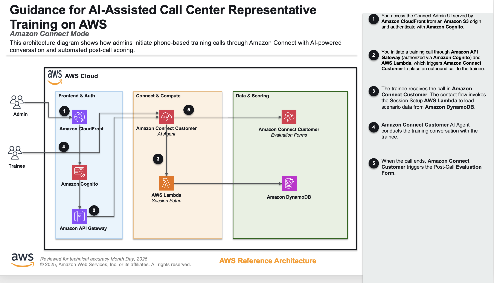

# Amazon Connect Integration - Architecture

## Overview

The Amazon Connect integration provides an alternative training delivery method alongside the browser-based Web UI. Instead of using a browser microphone, trainees receive phone calls via Amazon Connect's Contact Control Panel (CCP) softphone and interact with an AI customer powered by Lex V2 + Bedrock Claude.

## Architecture

## Components

### 1. Amazon Connect Instance

- **Type**: Existing instance referenced by ARN in `deployment/config.json`
- **Features enabled**:
  - Inbound & outbound calls
  - Call recording (stored in Connect S3 bucket)
  - Screen recording
  - Contact Lens analytics
  - Contact flow logs
- **Profiles**:
  - `Agent` security profile (built-in default)
  - `Basic Routing Profile` (built-in default)
  - Default BasicQueue (built-in default)

### 2. Connect Admin API Lambda

- **Location**: `src/lambda/connect_lambda/`
- **Trigger**: API Gateway (HTTP API)
- **Endpoints**:
  - `GET /scenarios` - List training scenarios from DynamoDB
  - `GET /agents` - List Connect representatives
  - `POST /start-call` - Initiate outbound training call via Connect

### 3. Rubric Scoring with Amazon Connect Evaluations

Everything after the call happens inside Amazon Connect — there is no post-call Lambda, and results are reviewed in the Amazon Connect admin website (**Analytics and optimization → Contact search / Evaluations**).

- **Evaluation form**: `ConnectEvaluationFormConstruct` generates a form from `rubrics/default.json` at deploy time — one section per rubric section, one Yes/No question per criterion answered by generative AI, question weights proportional to `max_points`, and "No" on a Critical criterion is an automatic fail. Connect answers at most 10 generative-AI questions per automatically evaluated contact, so synth fails if the rubric has more criteria.
- **Evaluated contact**: The AI customer's outbound call reaches the trainee's CCP as a separate **inbound** contact on the toll-free number, where the trainee is the AGENT. The `CallCenterTrainingInbound` flow tags it `training_evaluation=true`, enables recording + Contact Lens post-call analytics, and routes it to BasicQueue.
- **Auto-submit rule**: A Contact Lens rule (`CallCenterTrainingAutoEvaluation`, trigger *post-call analysis available*, condition `training_evaluation = true`) submits an automated evaluation with the form on every trainee contact.
- **Changing the rubric**: Edit `rubrics/default.json` and redeploy. Per-scenario criteria toggles in the Web UI admin do not apply to Connect evaluations.

### 4. Contact Flows

Contact flow in `amazon-connect/`:

**AIAgentFlow** - AI conversation loop for training calls:
1. Invoke Session Setup Lambda to inject scenario data
2. Connect Assistant block (AI Agent) handles conversation
   - Uses speech-to-speech with Amazon Nova Sonic
   - AI Agent references scenario data via custom session attributes
   - Conversational AI bot orchestrates the interaction
3. Disconnect when session ends

### 5. Admin UI

- **Location**: `connect-admin/app/`
- **Technology**: React + Vite + Cloudscape Design + AWS Amplify
- **Features**:
  - Cognito authentication (admin-only, no self-signup)
  - Scenario selection
  - Representative username input
  - Start training call button (the only admin function — scores and transcripts are in Amazon Connect)
- **Hosting**: CloudFront + S3

### 6. AI Agent Session Setup Lambda

- **Location**: `src/lambda/ai_agent_session_setup/`
- **Trigger**: Amazon Connect contact flow (synchronous invocation)
- **Purpose**: Injects scenario data into Amazon Connect AI Agent sessions before conversation starts
- **Function**: 
  1. Receives contactId and scenario_id from contact attributes
  2. Retrieves session information from Amazon Connect (with exponential backoff retry for timing)
  3. Loads scenario from DynamoDB Scenarios table
  4. Injects scenario fields into AI Agent session as custom data
  5. Returns success response to contact flow
- **Retry Logic**: Handles timing issues with exponential backoff (5 attempts, 0.5s to 8s delays)

### 7. AI Agent Architecture

Training calls use **Amazon Connect AI Agents** for natural conversation simulation.

**Architecture Flow:**
1. Admin initiates call via Admin API Lambda
2. Amazon Connect places outbound call to trainee
3. Contact flow invokes Session Setup Lambda (synchronous)
4. Session Setup Lambda injects scenario data into AI Agent session
5. Contact flow invokes AI Agent block
6. AI Agent uses orchestration prompt referencing `{{$.Custom.*}}` variables for scenario data
7. AI Agent calls Amazon Bedrock (Claude Haiku) for conversation orchestration
8. Amazon Connect handles speech-to-text and text-to-speech automatically
9. When the trainee's contact is analyzed, Contact Lens auto-submits the rubric evaluation (see section 3)

**Key Components:**
- **AI Prompt:** Orchestration prompt template with scenario variables (created in Amazon Connect console under AI Agents)
- **AI Agent:** Agent configuration linking prompt to Bedrock model (created in Amazon Connect console under AI Agents)
- **Session Setup Lambda:** Deployed via CDK, injects scenario data before conversation starts
- **Contact Flow:** Invokes Session Setup Lambda before AI Agent block
- **Lex Bot:** Automatically created by Connect when AI Agent is configured (not a separate resource)

**Session Data Variables:**
The AI Prompt references scenario data using template variable syntax:
- `{{$.Custom.scenarioId}}` - Scenario identifier
- `{{$.Custom.name}}` - Scenario name
- `{{$.Custom.context}}` - Full scenario context (persona, situation, personal details)
- `{{$.Custom.initial_message}}` - Customer's opening line
- `{{$.Custom.key_challenges}}` - JSON string of challenges
- `{{$.Custom.success_criteria}}` - JSON string of success criteria
- `{{$.Custom.caller_gender}}` - Customer gender
- `{{$.Custom.characters}}` - JSON string of character data (duo scenarios - not currently supported in Connect mode)

All scenario data is available from the first conversation turn.

**Timing and Retry Logic:**
The Session Setup Lambda implements retry logic with exponential backoff (5 attempts, 0.5s to 8s delays) to handle timing issues during session initialization. This ensures scenario data is successfully injected before the AI Agent begins the conversation.

**Why Manual AI Prompt/Agent Setup?**
AI Prompts and AI Agents are created in the Amazon Connect console rather than deployed via CDK. This allows for easy prompt iteration and testing without redeployment. The prompt template is provided in `amazon-connect/ai-agent-prompt-template.txt` for reference.

## Shared Resources

The following resources are shared between Web UI and Connect modes via the `CallCenterTraining-Core` stack:

| Resource | Used By Web UI | Used By Connect |
|----------|---------------|-----------------|
| VPC | Yes | Yes |
| S3 Recording Bucket | Yes (sessions/) | No (Connect stores recordings + analysis in its own bucket) |
| KMS Encryption Key | Yes | Yes |
| DynamoDB Tables | Yes (scenarios, sessions) | Yes (scenarios) |
| AgentCore Runtime | Yes (via WebSocket from browser) | No (Connect uses Lex + Claude directly) |

## Recording Storage

Web UI recordings live in the shared recordings bucket under `users/{user_id}/sessions/{session_id}/`. Connect call recordings and Contact Lens analysis stay in the Connect instance's own recordings bucket and are viewed in the Amazon Connect admin website.

## Authentication

| Component | Auth Method |
|-----------|------------|
| Web UI | Cognito User Pool -> Identity Pool -> IAM credentials |
| Admin UI | Separate Cognito User Pool -> Identity Pool -> IAM credentials |
| CCP | Connect-managed user directory |
| Connect Lambdas | IAM role (Lambda execution role) |

## Key Design Decisions

1. **Separate Admin UI**: Admin UI is a separate React app (not a route in the existing frontend) because it serves a different purpose, has different auth requirements, and deploys to a different stack.

2. **Connect-managed identity**: Simplest setup - representatives are created directly in Connect rather than federated. For production, SAML/OIDC federation could be added.

3. **Post-call scoring in Connect**: Connect records and analyzes the trainee's contact with Contact Lens, and a Contact Lens rule auto-submits an evaluation using a form generated from the rubric. No custom post-call code runs.

4. **AI Agent conversation engine**: Training calls use Amazon Connect AI Agents for natural conversation simulation. The Session Setup Lambda injects scenario data before the conversation starts, making all context available to the AI from the first turn. AI Prompts and AI Agents are configured in the Amazon Connect console for easy iteration.

5. **Unified configuration**: All Amazon Connect setup (AI Agents, prompts, contact flows, security profiles) is managed through the Amazon Connect console. The Lex bot used by the AI Agent is automatically created by Connect when the AI Agent is configured, simplifying the architecture.
